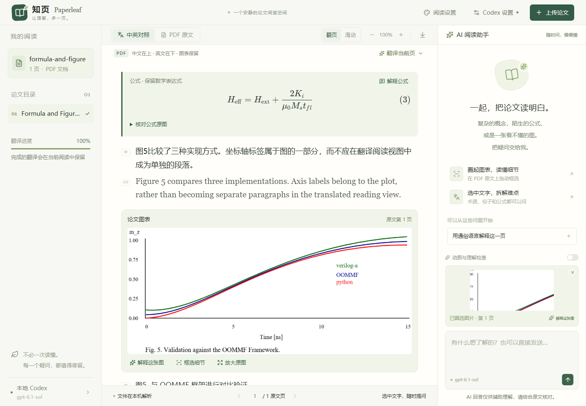

# 知页 · Paperleaf

**上传一篇论文，把不懂的地方慢慢读明白。**

知页是运行在电脑本机的 PDF 论文阅读器。通过你已经登录的 Codex，识别英文、翻译为中文、解释选中的文字和图表，在需要时用交互图示辅助理解，在你要求练习时提供检查题。


## 下载与启动

### Windows：推荐下载便携版

1. 安装 [Node.js](https://nodejs.org/)（22.13 或更新版本，包含 npm；推荐使用当前 LTS）。
2. 安装并登录 [Codex 桌面应用](https://developers.openai.com/codex/app)，或安装 [Codex CLI](https://developers.openai.com/codex/cli)。
3. 到 [Releases 下载页面](https://github.com/wanghan-star/paper_reader/releases/latest) 下载 **paperleaf-reader.zip**，也可以点击 [直接下载便携版](https://github.com/wanghan-star/paper_reader/releases/latest/download/paperleaf-reader.zip)。
4. 完整解压到可写的文件夹，例如 Documents/Paperleaf；双击 **Start-Paperleaf.cmd**。
5. 首次启动会联网安装本应用依赖，等待完成后自动打开浏览器。后续直接双击同一文件即可。

右上角打开 **Codex 设置 → 测试连接 → 保存设置**。模型从本机 Codex 自动读取，点击下拉框选择，不必填写 API Key。没有检测到时，先打开并登录 Codex，再点 **重新检测本机**。

需要桌面图标时，在应用文件夹用 PowerShell 运行：

```powershell
powershell -NoProfile -File .\scripts\install-desktop.ps1
```

以后双击桌面的 **知页 · 论文阅读** 即可。请保留应用文件夹。

### macOS / Linux

同样需要 Node.js 和已登录的 Codex。下载并解压便携版后，在终端进入该目录：

```sh
sh Start-Paperleaf.command
```

macOS 可执行 chmod +x Start-Paperleaf.command 后双击。跨平台检测和启动入口已实现；目前实机验证平台为 **Windows**。

### 从源码运行

也可点击仓库 **Code → Download ZIP** 获取源码，或运行：

```sh
git clone https://github.com/wanghan-star/paper_reader.git
cd paper_reader
npm ci --include=dev --include=optional
npm run build
node scripts/desktop-launch.mjs
```

源码需要构建；Release 便携版已包含页面构建产物。首次下载依赖失败时，检查网络后重新运行启动文件即可。

## 怎么读论文

1. **上传 PDF**：点击上传或拖入文件，支持 60 MB、350 页以内的论文。加密 PDF 先解锁。
2. **自动翻译**：默认上传后逐页识别版面并翻译全文，按完整自然段呈现「中文在上、英文在下」。印刷换行合并，图内坐标与标签保留在图片中，避免几词一段。扫描件同样支持。可在设置中关闭自动翻译，手动翻译当前页或全文。
3. **解释难点**：拖动选中文字，点「解释这段」；段落旁也有提问按钮。中英对照中保留论文图表与表格，可直接放大、解释整图或「框选细节」后提问；「PDF 原文」也可以圈选。
4. **持续追问**：回答显示在右侧助手，文字逐步生成；Enter 发送，Shift+Enter 换行。可以停止回答或翻译。
5. **自动保存**：译文、对话和难点会自动保存在应用文件夹的 records 目录，刷新或重启后自动回到上次阅读的论文；左侧“最近阅读”可切换或删除记录。再次上传同一份 PDF（即使改了文件名）会直接恢复，不重复识别。
6. **对照定位**：在中文或英文里选中文字，另一种语言中对应的句子会同时高亮。
7. **导出译文**：工具栏下载按钮导出逐句中英对照 Markdown。

目录、页码及圈选上下文始终对应原始 PDF 页码。双栏提取顺序不理想时，可以使用「视觉识别并翻译此页」。

v0.1.2 起，待识别页面先保留整页原文，完成后展示正文、公式、原始图片和双语图注。识别需要等待模型响应。图表从 PDF 本地渲染，包含矢量绘图和嵌入图片，不由 AI 重绘。识别失败时原页继续保留，可重新识别或换模型。



## 像老师一样讲解

开启助手下方 **导师模式**（默认开启）。v0.1.4 起，是否画图、是否出检查题由 AI 根据内容的复杂程度自行判断。

- **复杂才画图**：流程复杂（不少于 5 个环节，或有分支、汇合、循环）画**流程图**；机理复杂（至少 3 个部件、4 次以上相互作用，可含反馈回路）画**机理图**；3 个以上数据点的数量或趋势对比用柱形或曲线。两三步就能说完的内容不画图，达不到门槛的图会被直接丢弃，只保留文字回答。图可逐步播放、点击环节查看说明、放大。
- **讲到难处才出题**：抽象概念、公式推导、易混淆或反直觉的结论，AI 会附一道检查题（可先看提示）；术语全称、翻译、单一事实只用文字回答。上一道题还没作答时不会连着出题。
- **你说了算**：说“只用文字解释”“不要出题”当次不出；明确说“画成流程图”“考考我”当次必出。提交自己的理解时先得到反馈，不再追加题目。
- **本页难点（你要的时候才生成）**：在助手里点“找出这一页的难点，考考我”，或直接输入“标出本页难点”，AI 才会通读当前页，在右侧助手栏列出最多 3 处难点和思考题。正文里不插入卡片；点卡片上的页码可定位并高亮对应段落。可以“我来回答”让 AI 检查理解，或“直接讲给我听”。
- 每个回答下方有“讲得再简单一点 / 举个具体例子 / 画成图解 / 考考我”快捷追问。助手首页可一键获取“这篇论文的阅读路线”。

[查看按需教学设置界面](docs/images/settings.png)


- 选择答案后立即查看正误与解析；也能用自己的话回答，让 Codex 检查理解或继续举例。
- 流程图、机理图和动画都使用预先实现的绘图组件，通过模型生成并经过校验的数据驱动，减少等待整段演示代码生成的时间。回答速度仍取决于模型、网络和问题长度。

图中数值是教学示意，不是论文的真实实验数据。缓存对比只说明 K/V 投影是否重复计算，注意力仍读取历史上下文。

## 阅读与外观

- **布局**：工具栏左侧按钮可收起论文目录、加宽正文；拖动助手栏左边缘调整宽度（双击恢复）。翻页模式下标题区只在第一页显示，顶部栏显示论文标题与当前页。布局会记住。
- **公式排版**：结合整页图像识别分式、上下标及公式编号，使用 KaTeX 显示。独立公式可展开「核对公式原图」，含行内公式的段落可展开对应原图。无法辨认时直接保留原图；生成中的不完整公式会在完整后显示。
- **更多内容**：默认每个阅读页合并 2 页 PDF，可设置 1–4 页；支持紧凑排版。
- **翻页或滑动**：中英对照与 PDF 原文都支持连续阅读，长文按需渲染附近页面。
- **舒适字号**：默认正文 18 px，目录、按钮和设置说明也已增大；阅读设置可选 14–24 px，工具栏支持临时缩放。
- **主题**：森林纸白、暖杏、雾蓝、深夜以及自定义纸张颜色；深色背景会适配文字颜色。

主题、字号、模型和阅读方式保存在当前浏览器，下次打开仍生效。启动示例是原创 Transformer 教学文档，译文预先准备；上传真实 PDF 才执行真实翻译。

## 换电脑如何使用

将便携版复制到目标电脑，安装 Node.js 和 Codex 并登录，再运行该电脑的启动文件。知页会检测 **当前电脑** 的 Codex 安装、登录、可用模型及 Windows 本机代理，不复制原电脑的登录凭证。常用端口被占用时会自动选择空闲端口。

网页调用独立的临时 Codex 会话，不发送到已存在的桌面聊天。只打开网页链接不能访问另一台电脑的 Codex，需要在目标电脑运行本地启动器。

非常规 Codex 安装，可在启动前指定 CLI 路径。例如 Windows：

```powershell
$env:PAPERLEAF_CODEX_PATH = 'D:\Apps\Codex\codex.exe'
node scripts/desktop-launch.mjs
```

## 常见问题

**没有找到 Codex / 没有登录？** 在 Codex 应用中登录，或安装 CLI 并执行 codex login。回到设置点「重新检测本机」和「测试连接」。

**回答失败或一直等待？** 检查 Codex 自身能否回答、账户额度以及网络。知页沿用该机器的 Codex 登录；Windows 启用了本机系统代理时会为 Codex 子进程应用该代理。

**便携版第一次启动很久？** 首次需要下载本机平台的依赖，保持联网。之后直接复用已有依赖和本地服务。

**如何从旧版升级？** 将新版便携包完整解压到一个新文件夹，运行其中的 Start-Paperleaf.cmd，再按上面的步骤重新安装桌面快捷方式。把旧文件夹里的 records 目录复制到新文件夹，即可保留译文和对话。v0.1.4 之前的版本没有阅读记录，需要重新上传论文。

**提示译文不完整？** v0.1.1 起会缩小翻译批次，保留有效译文并自动补译缺失句子（每句最多尝试三次）。网页会显示句数进度和「正在自动补译」。仍未完成时，再点翻译会跳过已完成的句子；也可以在 Codex 设置里切换模型后继续。

**翻译或公式不准确？** 查看 PDF 原文；扫描图可能模糊，AI 也可能误解术语或图表。重新识别当前页，或缩小选区问更具体的问题。

**改完代码如何更新？** 关闭该应用的本地服务，重新 npm run build，再启动。启动日志位于本机 .sites-runtime 文件夹。

## 数据与额度

PDF 在浏览器本机解析，整个 PDF 原件不上传。v0.1.2 的版面识别会将每个需翻译页面的**整页渲染图像与辅助文本**发送给 Codex；问答所需文字、选区截图和上下文也会发送，使用已登录账户的额度。图表显示与裁剪在本机完成。整页识别的耗时和额度使用取决于页面复杂度与模型。

服务只监听 127.0.0.1，检查 Host 与 Origin。调用使用只读临时会话，不写入常规 Codex 聊天历史。阅读记录（译文、对话、难点和一份 PDF 副本）以普通文件保存在应用文件夹的 records 目录，只在本机，不上传；在“最近阅读”中删除会同时删除这些文件。任务结果在本地内存最多保留 30 分钟；临时截图在处理结束后清理。强制退出或断电可能遗留系统临时文件。应用不读取或向网页传递登录令牌，仓库与便携包不包含登录凭证。

## 开发与验证

React 19 / TypeScript / Vite + Vinext、PDF.js、KaTeX、本地 Node.js 网关、Codex CLI 与 app-server。教学图由受限结构化数据驱动，不注入 AI 生成的可执行 HTML。

```sh
node node_modules/typescript/bin/tsc --noEmit
node --test tests/*.test.mjs
npm run build
npm start
```

npm run dev 只启动前端框架，不包含本地 Codex 网关。完整运行使用桌面启动器或 npm start。当前自动测试、生产构建及浏览器交互检查通过，并已验证真实 Codex 翻译、OCR、图表解释和教学调用。详见 [验证记录](验证记录.md) 与 [完整使用说明](使用说明.md)。
